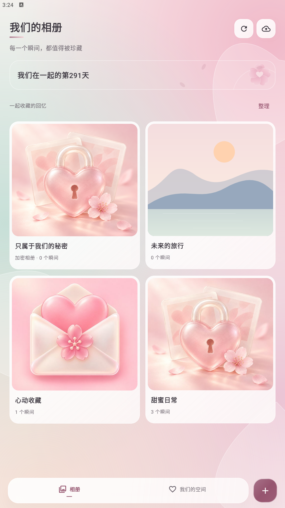
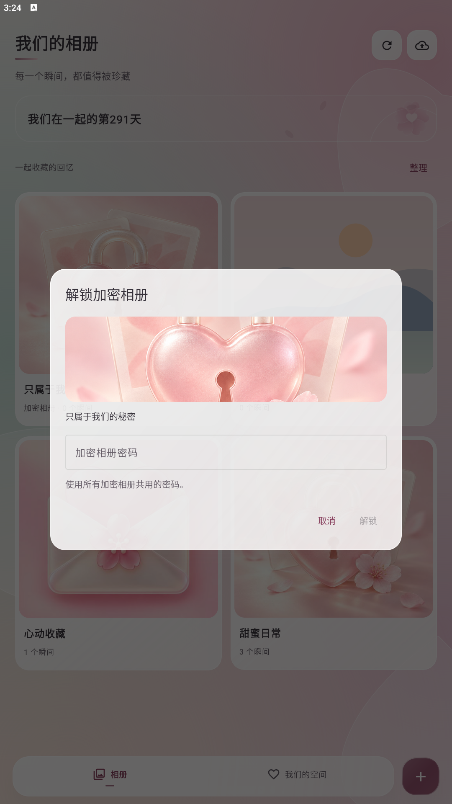
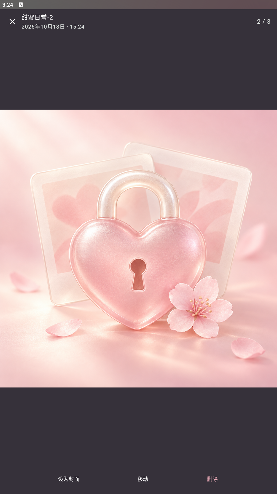
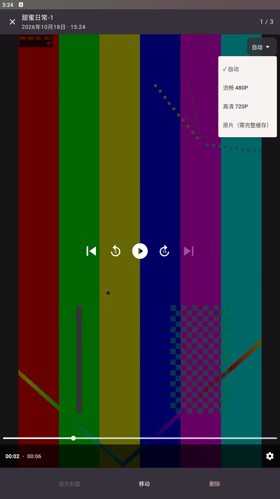
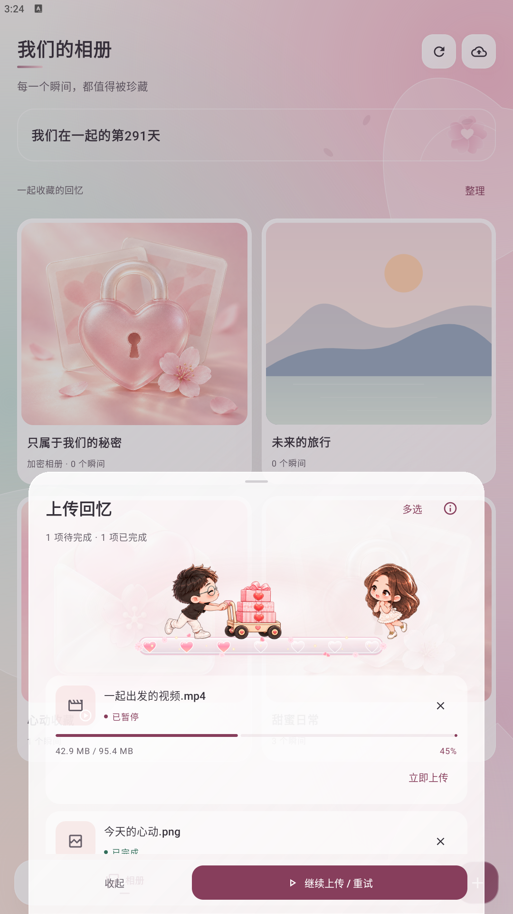
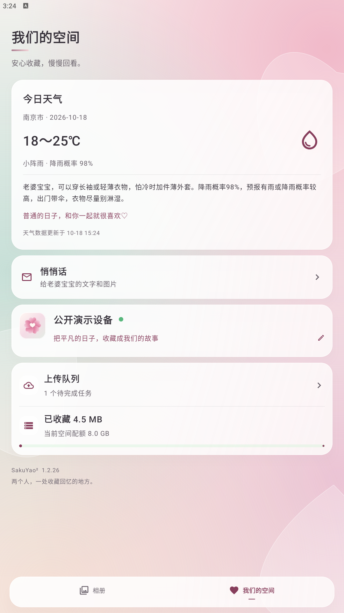
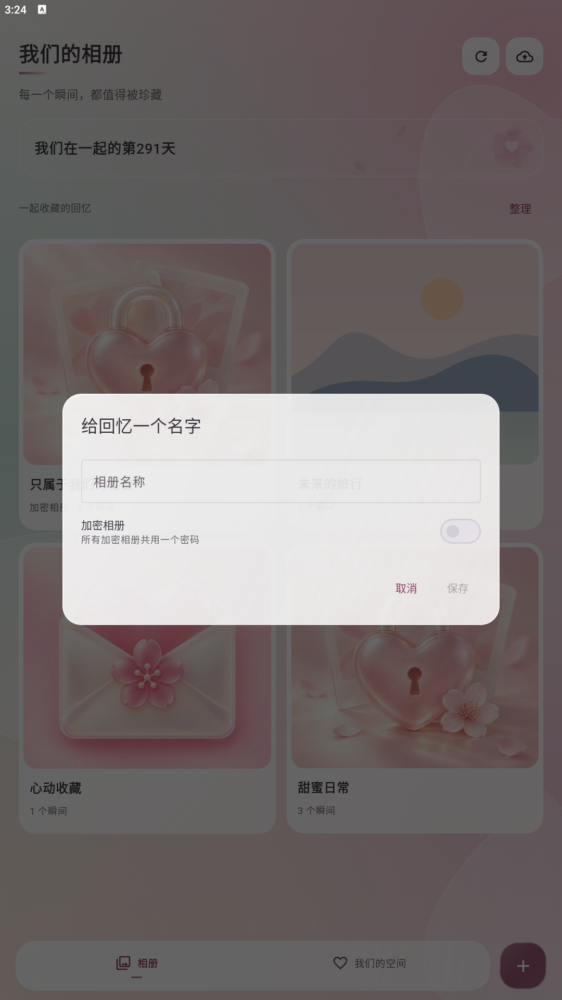
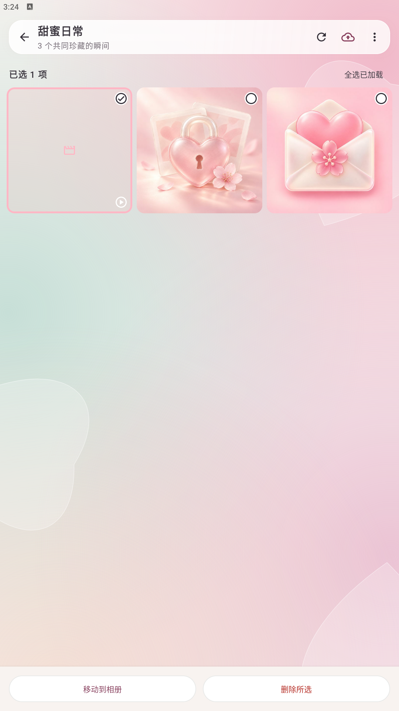
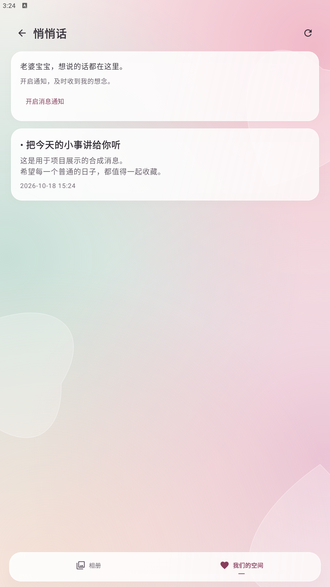
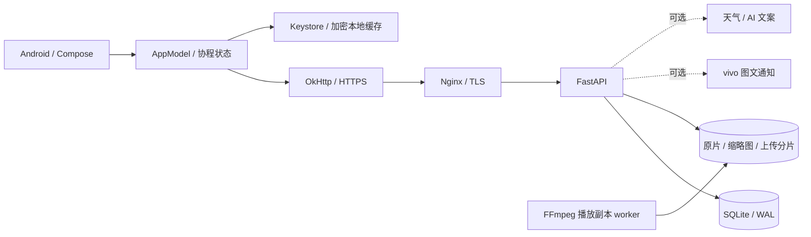

<div align="center">


# Couple Album · 情侣私密相册

**把平凡的日子，收藏成我们的故事。**

Android 情侣相册 · 原片珍藏 · 实况照片 · 断点续传 · 樱花 Loading

Kotlin · Jetpack Compose · Media3 · FastAPI · SQLite · Docker

[实际界面图集](docs/screenshots.md) · [功能详解](docs/features.md) · [架构与源码分析](docs/architecture.md) · [本地运行](docs/development.md) · [验证记录](docs/verification.md) · [简历介绍](docs/resume.md)

</div>

## 项目介绍

Couple Album（App 内名称 **SakuYao²**）是一套可以自行部署的 Android 情侣相册。两个人共同管理照片、视频与相册，用独立设备凭证连接同一个私人空间；可为部分相册设置密码，上传中断后继续传输，也可以查看 Live Photo 和接收图文悄悄话。

当前源码版本 **1.2.26 / versionCode 51**，支持 **Android 8.0+**。现有产品模型为一个空间、最多三台设备，适合两个人及其中一人的备用手机。公开版保留核心代码、测试与动画设计源文件，使用示例地址和演示文案；不包含私人照片、线上数据库、签名私钥或生产凭据。

## App 实际界面

以下为 **Android 9 模拟器中运行 Debug App 后直接截取的原生界面**。共 14 张，完整图片、功能说明和复现方式见 [界面图集](docs/screenshots.md)。

| 相册与纪念日 | 私密相册解锁 | 图片浏览 |
|:---:|:---:|:---:|
|  |  |  |
| **视频清晰度切换** | **上传队列与 Loading 进度条** | **空间设置** |
|  |  |  |
| **创建相册** | **批量整理媒体** | **悄悄话收件箱** |
|  |  |  |

截图使用通用插画、合成测试视频及演示设备/消息，本地演示后端提供实际 API。上传队列的 45% 暂停和已完成条目由测试注入固定 UI 状态，用于展示进度与操作，不代表网络性能测量。当前截图没有覆盖 Live Photo、真实推送和后台续传等所有场景；完整功能对应源码见 [功能详解](docs/features.md)。

## 四套加载动画

下面的图及 GIF 使用 **App 当前打包的四套 Lottie JSON** 在浏览器中渲染，展示各主题完整动作。它们与上面的 Android 原生界面截图分别标注；浏览器进度由演示输入控制。


| 视频加载 | 图片加载 |
|:---:|:---:|
|  |  |
| 双人趴姿、胶片轨道、完成亲吻 | 拍立得动作、照片逐张显色 |
| **上传队列** | **通用加载** |
|  |  |
| 推爱心小车、七颗爱心按进度点亮 | 毛玻璃胶囊、樱花节点随进度移动 |

动画的 **100% 等待态** 与 **成功完成态** 分开控制：字节传输结束后，仍需等待业务成功，才播放约 800 ms 的完成动作。快速缓存命中会跳过媒体加载动画；未知进度不会伪造百分比。

## 功能一览

| 功能 | 用户体验 | 实现要点 |
|---|---|---|
| 情侣共享空间 | 两个人在多台手机查看同一份回忆 | 一次性邀请、设备独立 Token、最多三台有效设备 |
| 相册管理 | 新建、重命名、封面、置顶、长按拖动排序 | 排序 revision 防止并发覆盖；按置顶分组整理 |
| 照片与视频 | 网格预览、左右翻页、多选移动和删除 | 分页、缩略图、原片保留、鉴权媒体流 |
| 私密相册 | 普通相册直接浏览，私密相册输入共享密码 | Argon2id、解锁会话、后台重锁、服务端权限校验 |
| 大文件上传 | 选择后自动进入队列，暂停、重试、断点续传 | 单文件上限默认 2 GiB；SHA-256 校验；服务端 offset 恢复 |
| 并发分片 | 弱网中断后保留已确认上传进度 | 1 MiB 分片、3 路并发、12 片接收窗口；兼容顺序上传 |
| 后台上传 | 切到其他应用后，已启动任务继续传输 | Android 前台服务、通知栏暂停、持久化任务队列 |
| Live Photo | 显示“实况”标记，按住播放、松手停止 | Apple ContentIdentifier 配对；分组后分页；完整加密缓存 |
| 视频播放 | 播放、拖动、清晰度选择、原片与兼容副本 | Media3、HTTP Range、HLS、FFmpeg 独立 worker |
| 悄悄话 | 收件箱展示文字和图片，记录已读 | 管理端发送接口、幂等请求、可选 vivo 推送、共享收件箱 |
| 纪念日与签名 | 首页纪念日、共享个性签名、天气卡片 | 签名版本控制；天气与可选 AI 文案；示例纪念日可修改 |
| 备份与恢复 | 导出数据库、媒体和校验清单，恢复到新目录 | SQLite 一致性快照、文件哈希、恢复后设备凭证失效 |

“私密相册”是**密码访问保护**。服务端能够读取原始媒体；项目没有实现媒体端到端加密。手机凭证和部分本地媒体缓存另有加密保护。悄悄话当前是管理端发送、App 接收的消息功能，不是双向即时聊天。

## 工程亮点

- **可靠上传链路**：区分已发送字节与服务端连续确认 offset；并发乱序到达时保留可恢复边界；校验、原子落盘完成后才公布媒体。
- **实况照片完整链路**：从 Apple 元数据识别、同相册配对、分组分页，到按住播放、首帧和完整缓存控制；不靠文件同名猜测配对。
- **媒体原片与播放副本分离**：原片保留，兼容转码和自适应播放由独立 FFmpeg worker 处理，并沿用相册访问控制。
- **加载状态与视觉联动**：四套 Lottie 主题使用同一套进度与完成状态机制，覆盖队列、图片、视频和通用等待。
- **服务端权限贯穿媒体读取**：Range、缩略图、原片、播放副本均进行授权检查；媒体流在分块发送前复查权限。

## 架构



## 快速开始

后端使用 Unix 文件锁，建议在 **Linux、macOS 或 Linux 容器**中运行。Python 3.12+；Android 需要 JDK 17、SDK 35，工程已提供 Gradle Wrapper。

```bash
python3 -m venv .venv
source .venv/bin/activate
pip install -r backend/requirements-dev.txt -c backend/constraints.txt
cd backend
export SAKURA_DATA="$PWD/../.tools/local-data"
export SAKURA_RESERVE_BYTES=0
python -m uvicorn sakura.main:create_app --factory --host 127.0.0.1 --port 8000
```

上述 HTTP 入口用于本机 API 调试。**Android 使用 HTTPS**；完整本地证书、模拟器演示和构建步骤见[开发指南](docs/development.md)。可选推送、AI 文案和正式签名需要所有者自行配置。

```bash
# 后端测试：另开终端，激活同一个虚拟环境
cd backend
python -m pytest -q

# Android 调试构建
bash scripts/qa-certificate.sh
cd android
bash gradlew testDebugUnitTest assembleDebug
```

## 目录

```text
android/                  Android 应用、单元测试、设备测试
backend/sakura/           API、权限、存储、消息、媒体处理
backend/tests/            后端回归测试
deploy/                   Docker Compose、Nginx、配置示例
scripts/                  构建、QA、演示及管理辅助脚本
design/loading/           第三版加载动画源文件与离线预览
docs/                     功能、架构、API、验证与简历材料
.github/workflows/        Linux 后端验证与 Android 演示截图流程
```

详细验证结果以[本次验证记录](docs/verification.md)及 [GitHub Actions](https://github.com/Sakura-Cui/couple-album/actions) 为准。测试截图中的媒体、设备和消息均应使用演示数据。
