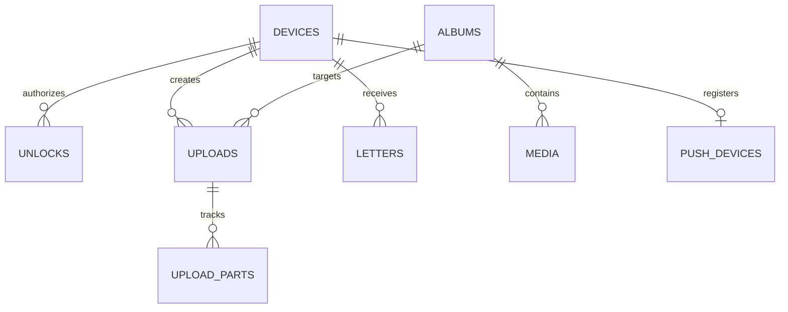
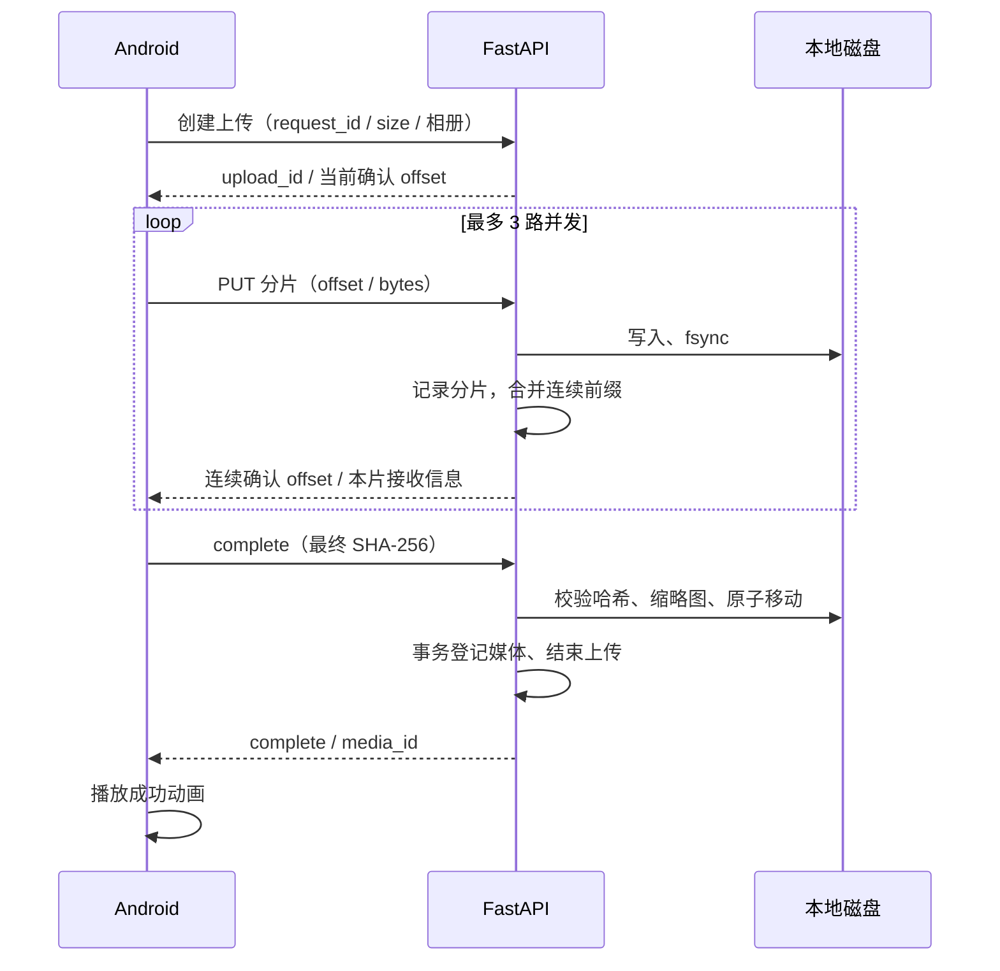

# 架构与源码分析

## 分析范围

以交接包中 1.2.26 当前 Android、Python 和部署源码为主体，历史日志只用于理解演变。原压缩包保持不变；公开目录独立整理。交接清单所列 3071 个文件中，19 处哈希差异与打包报告声明的历史日志脱敏完全一致，没有发现额外源码完整性差异。

公开版替换原服务器地址、厂商 AppID 默认值、私人称呼和纪念日示例；同步修改受影响的示例断言。补齐当前版本元数据，新增说明、展示页面、截图测试与 CI。原始历史运维报告、发布 APK、缓存和旧设计迭代未纳入公开仓库。

## 端侧模块

| 模块 | 职责 | 主要文件 |
|---|---|---|
| 生命周期入口 | 开屏、后台锁定、通知跳转、天气刷新 | MainActivity.kt / RomanceApplication.kt |
| 应用状态 | 绑定、会话、相册、媒体、队列及协程协调 | AppModel.kt / AppModelUploadTransfer.kt |
| 传输层 | HTTPS、Bearer、解锁凭证、连接变更取消 | Api.kt |
| UI | 相册、私密解锁、媒体预览、队列、设置 | *Screen.kt / MediaViewer.kt / UploadSheet.kt |
| 上传 | 分片并发、源文件读取、恢复和服务通知 | UploadTransfer.kt / UploadQueue.kt / UploadService.kt |
| 媒体 | 视频播放、原片缓存、实况准备、加密缓存 | VideoPlayer.kt / LivePhoto.kt / StreamCache.kt |
| 凭证与缓存 | Keystore、AES-GCM 预览、视频缓存密钥 | Vault.kt / PreviewCache.kt |
| 视觉 | 主题色、毛玻璃、樱花粒子、四种 Lottie | GlassUi.kt / SakuraParticleView.kt / SakuraLoading.kt |
| 附加体验 | 共享签名、纪念日、天气、图文收件箱 | SignatureHeader.kt / Anniversary.kt / InboxModel.kt |

Compose 观察状态驱动 UI，OkHttp 与协程处理网络。主要业务状态仍集中在 AppModel；上传和收件箱已有部分拆分。播放器操作与 Compose 可观察状态的提交需要保持 Main 线程语义。

## 服务端模块

| 文件 | 责任 |
|---|---|
| main.py | 设备/密码/相册/上传/媒体 API，请求体限制和异常处理 |
| storage.py | SQLite schema 与迁移、事务连接、写锁、配额、邀请 |
| objects.py | 本地文件与保留的 COS 适配层 |
| media_response.py | Range 解析、媒体响应、分块权限检查 |
| live_photos.py | Apple 静图/动态元数据解析、配对、分组 |
| playback.py | 副本状态、FFmpeg 指令、worker、HLS 资产 |
| messages.py | 图文收件箱、发送管理鉴权、幂等和 vivo 推送 |
| morning.py | 天气、时区、缓存、AI 文案与降级 |
| admin.py | 邀请、撤销、备份、恢复、过期数据清理 |

API 使用 SQLite WAL 和事务串行协调元数据更新，文件写入使用应用级 Unix flock。CPU/IO 较重的保存工作由独立执行线程处理；转码由单独容器 worker 执行。当前 Compose 设置偏向小规模私有空间，而非横向扩展的多租户服务。

## 数据模型

相册/媒体是空间级数据；设备 Token、上传任务、推送注册独立。`inbox_owner` 允许备用设备共享收件箱，不能简单把同名设备当成同一用户。`settings.version` 控制密码会话失效，签名和排序分别有自己的版本语义。`usage_totals` 由 SQLite 触发器更新以减少每片重新扫描。

## 上传一致性

关键设计是**可见传输量**与**可恢复持久化位置**分离。并发窗口允许后面的分片先落盘，但断点位置只能推进到没有空洞的连续前缀。完成过程中限制继续写片或取消，重复完成按已有状态返回。

## 媒体与缓存

原图、缩略图和播放副本均通过后端读取，不把媒体目录直接公开为静态路径。普通视频使用 Range、流缓存和必要的兼容副本；Live Photo 有独立的配对和完整缓存门槛。缓存键还绑定空间与设备凭据，减少跨连接复用的风险。

Android 预览缓存通过 AES-GCM 保护，视频流缓存通过 Media3 AES 数据源/数据汇保护，缓存密钥再受 Keystore 保护。服务端媒体仍为可读取的文件；这些机制不能推导出端到端加密或服务器磁盘加密。

## Loading 状态机

`SakuraLoading` 将 0–100 帧映射到业务进度，100–124 帧映射到约 800 ms 的成功段。进度更新进行约 220 ms 平滑过渡；媒体加载延迟约 200 ms 才展示，减少缓存命中时闪烁。未知总量使用不确定状态提示，不随时间累加虚构百分比。

`LoadingPresentation` 按操作编号保持成功段直到完成，避免新任务复用旧完成回调。组件生命周期不可见时暂停动画。上传队列进度按总字节加权；实况结束 loading 还需要完整字节缓存、播放器 READY 和首帧，不能只看网络回调。

## 已识别的限制和后续优先级

| 优先级 | 观察 | 影响与建议 |
|---|---|---|
| 高 | 设备上限、空间和共享收件箱规则是单空间模型 | 适合当前情侣场景；要做 SaaS 需增加用户/租户和权限边界，不能仅移除三设备限制 |
| 高 | Windows 不能直接导入 fcntl；部分备份路径/测试假设 POSIX | 后端明确使用 Linux/macOS/容器，先在 Linux 验收；本次 Windows 适配结果只作诊断 |
| 高 | 播放体验取决于原片编码、worker 和设备解码器 | 真机验证 HDR、方向、60fps、音画同步、弱网和实况重复按住 |
| 中 | AppModel 和 main.py 仍集中较多职责 | 未来按会话、相册、上传等业务边界渐进拆分，保持现有回归覆盖 |
| 中 | 历史 README/API/镜像默认版本存在滞后 | 公开版已对齐关键元数据；后续将版本来源统一并自动检查 |
| 中 | 部分 QA 脚本保留历史模拟器序列号与工具路径 | 使用新增隔离 CI 展示流程；运行旧脚本前检查路径和设备校验 |
| 中 | 存储配额/转码资源配置面向小规模单机 | 根据磁盘和并发真实压测调整；不承诺未验证的吞吐或并发指标 |

无当前真机或生产运行证据的功能，不能在简历中写成已经完成全机型、全弱网或当前生产验收。具体测试状态见 [verification.md](verification.md)。
