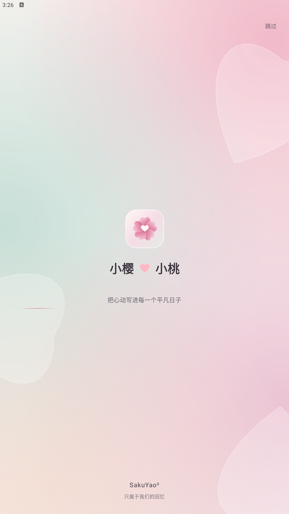
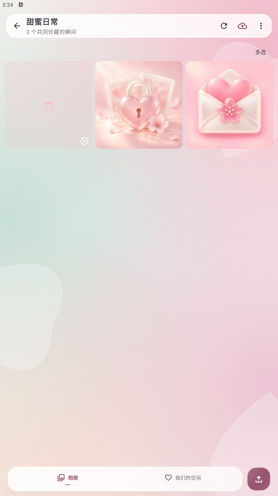
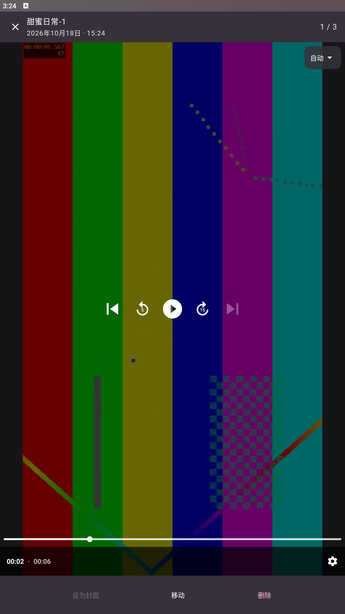
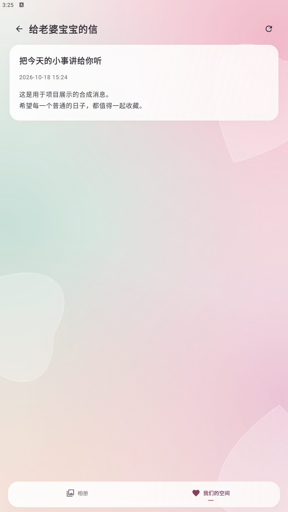

# App 实际功能截图

拍摄日期：2026-10-18。应用源码 1.2.26 / code 51；Android 9 模拟器，1080 × 1920。这里的 **14 张图片均来自实际运行的 Android App**，不是网页仿制或设计稿。

首页九宫格见 [README](../README.md#app-实际界面)。点击下方图片可打开原图。

## 截图与功能

| 启动页 | 相册首页 |
| :---: | :---: |
|  |  |
| 启动品牌页、情侣昵称与跳过入口。 | 展示相册封面、媒体数量、纪念日、新建入口及底部导航。 |

| 创建相册 | 私密相册解锁 |
| :---: | :---: |
|  |  |
| 输入相册名，并可开启加密相册访问保护。 | 锁定封面与密码输入弹窗；密码校验由后端执行。 |

| 相册媒体网格 | 批量整理 |
| :---: | :---: |
|  |  |
| 照片、视频及媒体数量；点击媒体进入查看器。 | 多选模式、全选/取消、移动到相册与删除所选。 |

| 图片等待状态 | 图片查看器 |
| :---: | :---: |
|  |  |
| 通过本地延迟接口捕获图片仍在请求时的实际等待界面。 | 原生全屏预览、当前页码、设为封面、移动与删除入口。 |

| 视频播放 | 视频清晰度 |
| :---: | :---: |
|  |  |
| Media3 播放、暂停、进度拖动和跳转控制；画面为 FFmpeg 合成测试视频。 | 实际 HLS 播放菜单：自动、流畅 480P、高清 720P 与原片入口。 |

| 上传队列与进度条 | 我们的空间 |
| :---: | :---: |
|  |  |
| 真实队列界面和 Lottie 爱心小车，显示 45% 暂停任务、完成条目及继续/重试等操作。数值为固定 UI 测试状态。 | 天气、共享签名、悄悄话、当前演示设备、上传队列与空间用量入口。天气值是拍摄时的演示环境结果。 |

| 悄悄话收件箱 | 悄悄话详情 |
| :---: | :---: |
|  |  |
| 消息列表、刷新和通知权限提示；消息通过本地管理端 API 写入。 | 消息正文和发送时间；当前功能为管理端发送、App 接收。 |

## 数据与拍摄方式

- 相册、媒体列表、图片、视频和消息使用本地演示后端的 API。媒体为通用插画与合成测试画面，不包含原用户照片。
- 上传队列通过测试注入固定的暂停/完成状态，45% 用于说明界面进度；截图不证明真实上传速度、断点恢复或后台传输。
- 自动化 `ShowcaseFlowTest` 通过真实界面导航，使用 Android `UiAutomation.takeScreenshot()` 保存 13 张图片；启动页另用 `adb exec-out screencap -p` 截取。没有拼画或修改 App 控件。
- 图片等待通过演示路由短暂延迟媒体响应捕获；视频使用准备好的 HLS 演示副本，不是完整转码 worker 回归验收。
- Live Photo、真实 vivo 推送、备份恢复、弱网和后台续传尚未在本轮原生截图测试中覆盖。功能是否存在以 [源码分析](features.md) 为准，测试边界见 [验证记录](verification.md)。

自动化源码：[ShowcaseFlowTest.kt](../android/app/src/androidTest/java/com/sakura/romance/ShowcaseFlowTest.kt)、[showcase_server.py](../scripts/showcase_server.py)。复现环境和命令见 [开发指南](development.md#android-演示截图)，文件哈希见 [native-capture.json](showcase/native-capture.json)。
